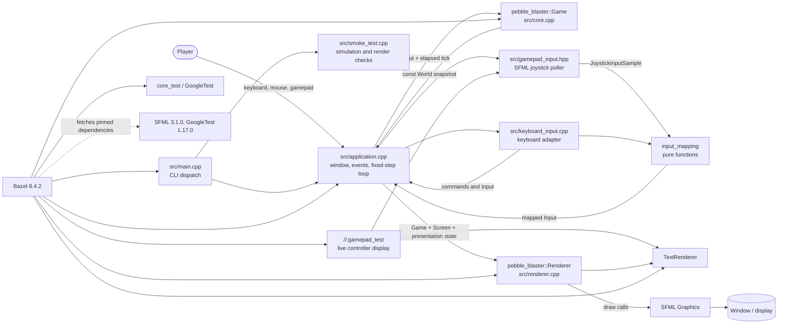
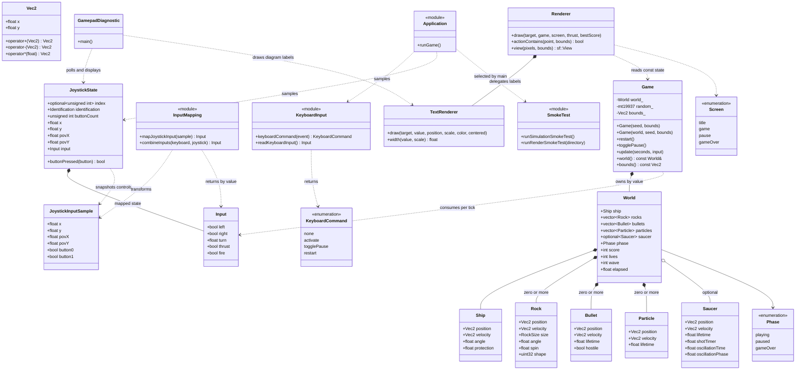
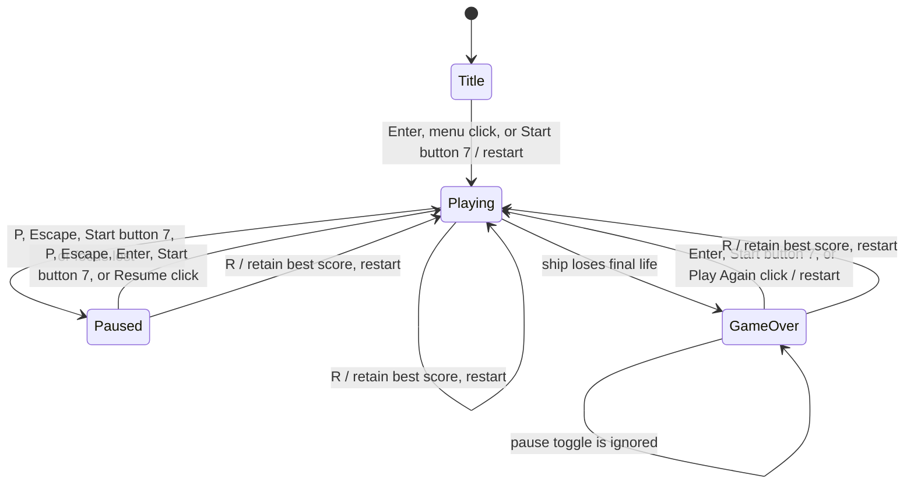
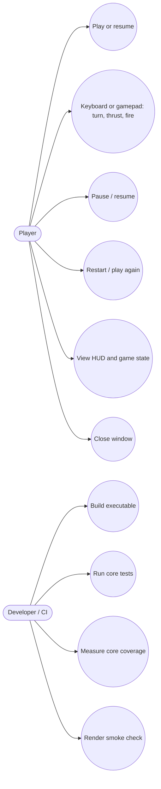
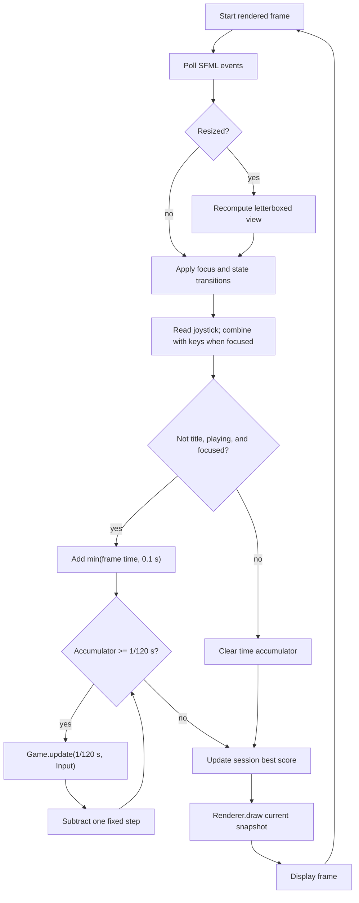
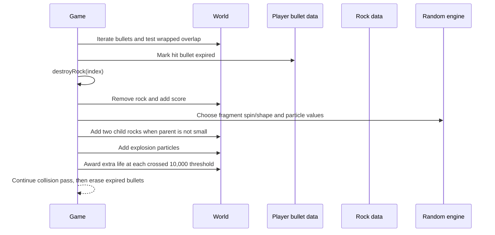
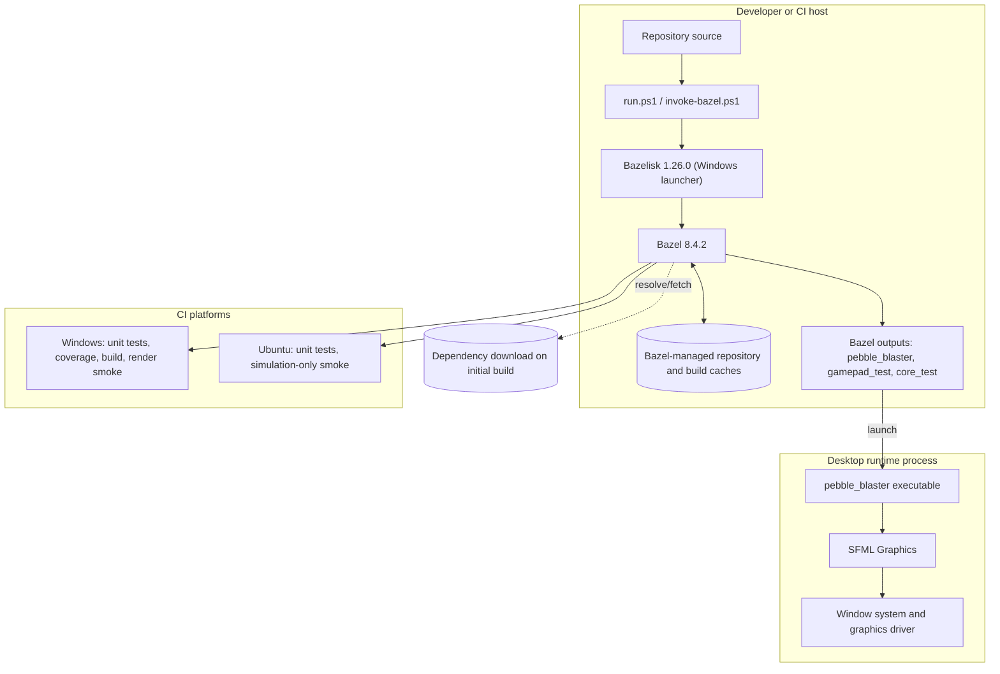
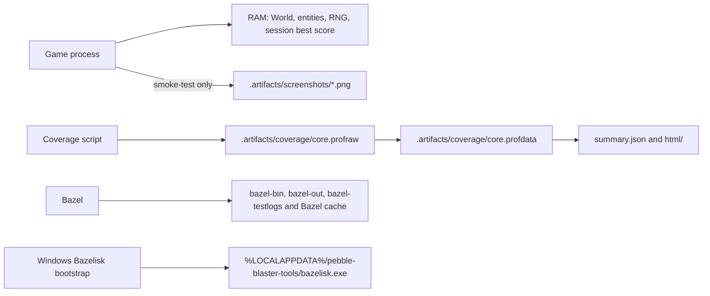
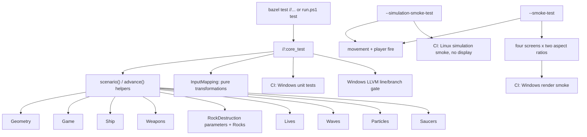

# Software Architecture

This document describes the implementation in `src/`, `include/pebble_blaster/`,
`tests/`, and the Bazel/PowerShell build entry points. It is intended as a
developer reference. The diagrams use Mermaid syntax and describe the current
code, including the separation between the simulation and the SFML presentation
layer.

## System Overview

Pebble Blaster is a single-process C++23 desktop game. The gameplay core is a
deterministic, SFML-independent simulation. `main.cpp` dispatches CLI modes;
`application.cpp` coordinates the window/event loop, keyboard and joystick
adapters, simulation, and renderer. `Renderer` draws gameplay geometry, while
`TextRenderer` owns the bitmap glyph table and text drawing. The
SFML-independent `input_mapping` library transforms joystick and keyboard value
snapshots into new `Input` values without mutating its arguments. A separate
gamepad diagnostic displays the detected device and live input mapping. Bazel
owns dependency resolution and build/test execution.



The core does not depend on SFML and can be tested without a display or graphics
context. Rendering and event handling are not part of the core coverage
measurement. The executable provides a display-free simulation smoke mode and
a separate OpenGL render smoke mode.

## Components and Dependencies

| Component | Responsibility | Depends on |
| --- | --- | --- |
| `core` | World state, rules, deterministic time-step simulation, collision and scoring | C++ standard library |
| `input_mapping` | Pure joystick sample mapping and input composition | `core`; no SFML |
| `renderer` | Procedural game geometry, HUD/menu layout, viewport and clickable action bounds | `core`, `text_renderer`, SFML Graphics |
| `text_renderer` | Bitmap glyph table, text measurement and drawing | SFML Graphics |
| `keyboard_input` | Keyboard command mapping and held-key sampling | `core`, SFML Window |
| `application` | Window/event orchestration, input combination, focus, accumulator, and session state | `core`, `input_mapping`, `renderer`, keyboard/gamepad input, SFML Graphics |
| `smoke_test` | Display-free simulation check and rendered screenshot check | `core`, `renderer`, SFML Graphics |
| `gamepad_input.hpp` | Samples the first connected SFML joystick into a value snapshot | `input_mapping`, SFML Window Joystick |
| `gamepad_test` | Live controller diagram, raw axis/button state, and mapped-action highlights | `input_mapping`, `text_renderer`, SFML Graphics |
| `core_test` | Headless unit tests for simulation and pure input mapping | `core`, `input_mapping`, GoogleTest |
| `run.ps1` and `tools/*.ps1` | Windows build/test/coverage/smoke entry points and Bazelisk setup | PowerShell, Visual Studio C++ tools; LLVM for coverage |



`World` and its entity types are value data, not active objects with their own
update methods. `Game` owns the mutable world and performs all simulation
mutations. `Game::world()` exposes a const reference, so callers can inspect but
cannot mutate live state through that accessor. The second `Game` constructor
accepts an already-created `World` for controlled scenarios; unlike the
seed-only constructor, it does not call `restart()` or create a starting wave.

## Runtime States

The application has a title flag in `runGame()` in addition to `World::phase`.
Consequently, the title screen is a presentation/application state and is not a
`Phase` value. The best score is also held by the application and lasts only for
the current process.



Pausing freezes simulation time because the application stops invoking
`Game::update`; `Game::update` also returns immediately when the phase is not
`playing`. Focus regain alone does not resume play. The title and game-over
action buttons are activated by a left click inside the renderer's action
rectangle; pause's action is Resume. Restart (`R`) is accepted on every
non-title screen and updates the process-local best score before resetting the
game.

## Use Cases



## Input and Public Contracts

### Construction and state

| API | Contract |
| --- | --- |
| `Game(seed, bounds)` | Defaults to bounds `1200 x 800`; rejects non-finite dimensions or dimensions below `400 x 300` with `std::invalid_argument`. Initializes a fresh world via `restart()`, placing the ship at center and spawning wave 1. |
| `Game(world, seed, bounds)` | Applies the same bounds validation and retains the supplied world as-is. It does not automatically restart, position the ship, or populate rocks. The seed controls subsequent random operations. |
| `restart()` | Replaces world state with default `World` values, places the ship at the playfield center, and spawns the current initial wave (wave 1). The `Game`'s random engine is not reconstructed, so a restart advances the existing random stream. |
| `togglePause()` | Switches `playing` and `paused`; has no effect in `gameOver`. |
| `world()` | Returns a const reference to the current world. Its lifetime is tied to the `Game`; callers must not retain it past the owning game. |

### Simulation tick

`Input` is a sampled set of controls: keyboard `left`/`right`, signed analog
`turn`, held `thrust`, and held `fire`. The core combines `turn` with the
keyboard booleans and clamps the result to `[-1, 1]`; opposed keyboard turns
cancel. Thrust accelerates while held; fire attempts to fire while held,
subject to cooldown and shot limits. The core does not know about keyboard
keys, mouse events, joystick APIs, or physical button numbers.

`Game::update(seconds, input)` follows these rules:

- Does nothing unless the phase is `playing` and `seconds` is finite and
  greater than zero.
- Caps an accepted tick to `0.05` seconds. The application normally supplies
  `1/120` second ticks, so this is a defensive core-level upper bound.
- Advances elapsed time and ship, rock, bullet, particle, and saucer state;
  expires transient objects; resolves collisions; then advances the wave timer
  when the rock field is empty.
- The coordinate space is toroidal: entities wrap across both edges, and
  collision distances use the shorter wrapped distance.

The application caps an individual rendered frame contribution to `0.1`
seconds and uses an accumulator to call `update(1/120, input)` zero or more
times per rendered frame. It clears the accumulator while in a menu, paused, or
unfocused, avoiding a large catch-up burst after a pause.

### Input mapping

| Game action | Keyboard / mouse | Gamepad |
| --- | --- | --- |
| Turn left / right | Left or A / Right or D | Left stick X outside a 20% dead zone; otherwise D-pad POV X at 50% or beyond |
| Thrust | Up or W | Dead-zoned left stick Y `< -0.5` or D-pad POV Y `< -50` |
| Fire | Space, held for repeated shots | Buttons 0 or 1, held for repeated shots |
| Pause / resume | P or Escape | Start, button 7, on a press edge |
| Start / resume / play again | Enter or click the menu action | Start, button 7, on a press edge |
| Restart | R, outside the title screen | - |
| Quit | Close window | - |

`readJoystick()` in `src/gamepad_input.hpp` is the impure device boundary: it
samples the first connected SFML joystick into a `JoystickInputSample` and
returns its detected device metadata. `mapJoystickInput()` is pure and returns
a new `Input`: it prefers D-pad POV X for turning when its magnitude is at
least 50%; otherwise it uses the dead-zoned X axis. Stick axes use a 20% dead
zone; thrust activates when dead-zoned Y is below `-0.5` or POV Y is below
`-50`. Buttons 0 and 1 feed `Input::fire`. `combineInputs()` returns a new value
without modifying either source. Button 7 is edge-detected in `application.cpp`
for start/pause and is not part of the core `Input` structure. Keyboard and
joystick gameplay input is applied only while the window is focused.

On focus loss, the application clears the focused-input flag and pauses an
active game. On focus regain it resumes sampling controls, but a paused game
remains paused until an explicit resume action.

## Gameplay Rules

- A new game starts with 3 lives, score 0, wave 1, a centered ship, and
  `min(3 + wave, 12)` large rocks. At wave 1 this is 4 rocks.
- Ship turning is `4.2` radians/second. Thrust acceleration is `310` world
  units/second squared; speed is capped at `420` and drag is exponential at
  `0.12` per second.
- The player can have at most 6 simultaneous non-hostile bullets. Fire cooldown
  is `0.16` seconds. Player bullets inherit ship velocity, travel at an
  additional `600` units/second, and live `1.1` seconds.
- Rock radii are 44 (large), 25 (medium), and 13 (small). Destroying a large
  rock creates two medium rocks; a medium creates two small rocks; a small
  creates no fragments. Each destruction creates 18 particles.
- Rock scores are 20 (large), 50 (medium), and 100 (small). A saucer is worth
  200. Every 10,000 points awards one life, with support for crossing multiple
  thresholds in one award.
- Ship collision protection starts at 3 seconds and is restored after a
  non-final hit. Losing the final life changes phase to `gameOver`; pause cannot
  leave that phase.
- A new wave starts after the field remains empty for the 2-second wave timer.
  Wave count increases without a cap; rock count caps at 12. Rock speed
  increases with wave number.
- Saucers are scheduled after a timer, live up to 10 seconds, move across the
  wrapped playfield with a 12-unit sinusoidal vertical weave, and fire hostile
  shots toward the ship with aim variation. Hostile bullets can hit the ship
  but do not destroy rocks.
- Resizing changes the viewport to preserve the playfield aspect ratio and
  letterboxes unused space; it does not resize the simulation bounds.

## Tick and Message Workflows

### Frame-to-tick workflow



### Object message exchange: one simulation update

The entities below are data objects. The messages show calls between the
application, `Game`, and renderer, plus the mutations `Game` performs on its
owned `World`; they do not imply that `Ship`, `Rock`, or `Bullet` implement
independent methods.

```mermaid
sequenceDiagram
    participant MainLoop as Application loop
    participant Input as Input sample
    participant Game as Game instance
    participant World as Owned World
    participant RNG as Random engine
    participant Renderer
    participant Target as SFML RenderTarget
    MainLoop->>Input: readJoystick(); combine with focused keyboard state
    MainLoop->>Game: update(fixedSeconds, Input)
    Game->>World: Check phase and elapsed time
    Game->>World: Move and wrap ship/entities
    Game->>RNG: Generate scheduled/spawned variation
    Game->>World: Resolve bullet and ship collisions
    Game->>World: Apply score, lives, fragments, effects, phase
    Game-->>MainLoop: Return with mutated World
    MainLoop->>Renderer: draw(Game const&, Screen, thrust, bestScore)
    Renderer->>World: Read snapshot through Game::world()
    Renderer->>Target: Draw scene and interface geometry
    Target-->>MainLoop: Present frame
```

### Collision, destruction, and score exchange



## Deployment and Build

The application has no service tier or network protocol at runtime. Network
access is needed on a clean build to fetch Bazelisk (Windows launcher) and
pinned Bazel dependencies; it is not needed by gameplay after the build.



### Build graph

`BUILD.bazel` defines `//:core`, `//:input_mapping`, and `//:renderer` (`cc_library`),
`//:pebble_blaster` and `//:gamepad_test` (`cc_binary`), and `//:core_test`
(`cc_test`). `input_mapping` depends on `core` and has no SFML dependency;
`renderer` depends on `core` and SFML Graphics and compiles `text_renderer.cpp`.
The game and gamepad diagnostic both depend on the shared input-mapping
library; `core_test` depends on `core`, `input_mapping`, and GoogleTest.
`MODULE.bazel` pins SFML 3.1.0 and GoogleTest 1.17.0, while `.bazelversion`
selects Bazel 8.4.2.

### Common commands

| Goal | Windows | Linux / macOS with Bazelisk |
| --- | --- | --- |
| Run game | `./run.ps1` | `bazelisk run //:pebble_blaster` |
| Gamepad diagnostic | `./tools/invoke-bazel.ps1 run //:gamepad_test` | `bazelisk run //:gamepad_test` |
| Run tests | `./run.ps1 test` | `bazelisk test //...` |
| Coverage | `./run.ps1 coverage` (Windows LLVM required) | Linux LCOV command in `README.md` |
| Simulation smoke | `./tools/invoke-bazel.ps1 run //:pebble_blaster -- --simulation-smoke-test` | `bazelisk run //:pebble_blaster -- --simulation-smoke-test` |
| Render smoke | `./run.ps1 smoke` (display required) | Windows CI only; requires compatible GLX visuals |

On Windows, `tools/invoke-bazel.ps1` discovers Visual Studio C++ tools, downloads
checksum-verified Bazelisk into the local application cache if absent, and
forwards the command to Bazelisk. `tools/coverage.ps1` builds and runs the core
test binary with LLVM instrumentation, emits JSON/HTML, and enforces the
configured line/branch thresholds (95% by default). See `README.md` for
platform prerequisites and full commands.

## Storage and Generated Artifacts

The game does not save scores, settings, replays, or user data. `World`, random
state, and the best score are process-memory state; best score is reset when
the application exits. The renderer generates its visual assets procedurally,
so there are no runtime font or texture files. `gamepad_test` opens a separate
SFML window for live controller diagnostics and does not persist device data.



| Location | Contents and lifecycle |
| --- | --- |
| Process memory | Live world, PRNG state, and current-process best score; discarded at exit. |
| `.artifacts/screenshots/` | Eight smoke images by default: four screens at `960x640` and `600x800`; generated by render smoke mode. |
| `.artifacts/coverage/` | Raw/merged LLVM profiles, coverage summary JSON, and HTML report; generated by the Windows coverage script. |
| `bazel-bin`, `bazel-out`, `bazel-testlogs` | Bazel output locations/symlinks for built artifacts and test logs; generated and rebuildable. |
| Bazel-managed cache | Downloaded repositories and build cache outside application-owned game data; location is controlled by Bazel. |
| `%LOCALAPPDATA%/pebble-blaster-tools/bazelisk.exe` | Windows Bazelisk bootstrap binary, verified against the pinned SHA-256 by the launcher. |

Generated build and `.artifacts` paths are ignored by `.gitignore`. No generated
location is read by gameplay as saved state.

## Tests and Coverage

### Test structure

`tests/core_test.cpp` contains GoogleTest cases organized by behavior. A helper
`scenario()` constructs a deliberately small world for isolated cases, while
`advance()` runs repeated deterministic ticks. The parameterized
`RockDestruction` suite is instantiated for all three `RockSize` values. The
current file defines 35 executed cases when those three parameter values are
counted separately.



### Suite and case catalog

| Suite | Cases and intended contract |
| --- | --- |
| `InputMapping` | `MapsStickDeadZoneAndDpadPriority` checks axis dead zone, POV priority, thrust, and fire mapping; `CombinesSourcesWithoutMutatingThem` checks keyboard/joystick composition and preserves source values. |
| `Geometry` | `VectorArithmetic` checks vector operations and direction; `WrapsNegativePositiveAndMultipleScreenCrossings` checks positive/negative multi-span wrapping; `CollidesAcrossEdgesAndIncludesTangency` checks toroidal overlap and inclusive radius tangency. |
| `Game` | `StartsWithThreeLivesAndFourSafeRocks` checks initial state and safe spawn distance; `RejectsInvalidPlayfields` checks dimensions and finiteness; `SeedReproducesWave` checks deterministic seeded wave generation; `PausingFreezesSimulationAndResumes` checks phase/time behavior; `IgnoresInvalidTimeAndCapsLargeSteps` checks invalid deltas and the 50 ms cap. |
| `Ship` | `TurnsBothWaysAndOpposedControlsCancel` checks angular input; `AcceleratesCoastsAndCapsSpeed` checks thrust, drag, and maximum speed; `WrapsAtThePlayfieldBoundary` checks ship position wrapping. |
| `Weapons` | `FiresForwardInheritsVelocityAndHonorsCooldown` checks direction, inherited velocity, and cooldown; `LimitsPlayerShotsButNotHostileShots` checks the six-player-shot limit; `BulletsWrapAndExpire` checks bullet movement and lifetime. |
| `RockDestruction` (parameterized) | `AwardsPointsAndSplitsIntoCorrectSize` runs for large, medium, and small rocks; checks score, bullet removal, particles, fragment count, and fragment size. |
| `Rocks` | `MoveRotateAndWrap` checks rock motion; `OneBulletDestroysOnlyOneRock` checks one-hit/one-rock resolution; `InvalidSizeIsRejected` checks invalid enum handling by `radius` and `points`. |
| `Lives` | `ProtectionPreventsCollisionsThenOneHitRespawns` checks protection, life loss, reset position, and re-protection; `LastHitEndsGamePauseCannotReviveAndRestartResets` checks game-over, ignored pause, and restart reset; `AwardsExtraLifeOncePerTenThousandPoints` checks score threshold behavior. |
| `Waves` | `EmptyFieldWaitsThenSpawnsNextWave` checks the inter-wave delay; `DifficultyCapsRockCount` checks the 12-rock cap. |
| `Particles` | `MoveWrapAndExpire` checks particle motion, wrapping, and lifetime removal. |
| `Saucers` | `TimerSpawnsSaucerAndItFiresAndExpires` checks schedule, hostile fire, and expiry; `WeavesSinusoidallyAroundItsBaseline` checks the vertical weave; `PlayerShotDestroysSaucerAndAwardsPoints` checks hit and reward; `ContactDamagesShip` checks contact damage; `HostileShotsDamageShipButNotRocksAndRespectProtection` checks hostile targeting/collision and protection; `AimUsesShortestWrappedDistanceOnBothAxes` checks toroidal aiming. |

### Verification layers

- **Unit tests:** `bazel test //...` or `./run.ps1 test`. The target is
  display-independent and tests the gameplay core and geometry through public
  contracts and controlled `World` scenarios.
- **Coverage:** `./run.ps1 coverage` instruments the core test binary and its
  `input_mapping` dependency with Windows Clang/LLVM. By default it fails below
  95% line or branch coverage. SFML and presentation code are excluded from
  this measurement; the coverage script also excludes tests and external code
  from the report.
- **Render smoke:** `./run.ps1 smoke` (or `pebble_blaster --smoke-test <directory>`)
  advances a seeded game with turn/thrust/fire input, verifies ship movement
  and that bullets exist, then renders title, game, pause, and game-over screens
  at landscape and portrait sizes. It requires an OpenGL-capable display and
  checks both a minimum lit-pixel threshold and successful PNG writes. It is an
  integration sanity check, not a pixel-perfect golden-image test.
- **CI:** `.github/workflows/ci.yml` runs Windows unit tests, coverage, a game
  build, and the full render smoke; Ubuntu runs unit tests and the
  display-independent simulation smoke. Windows uploads coverage and render
  screenshots.

The core tests use injected seeds and hand-built worlds to avoid depending on
uncontrolled game startup conditions. Tests assert gameplay outcomes rather
than implementation-private helper call sequences. Coverage is a separate
quality gate and does not replace assertions or the SFML rendering smoke check.

## Architectural Constraints and Extension Guidance

- Keep gameplay rules in `core` and keep this target free of SFML so simulation
  tests remain headless and deterministic.
- Add user input by mapping it to `Input` in the application; do not introduce
  keyboard or window APIs into `Game`.
- Render from `Game::world()` and presentation arguments. Avoid mutating
  gameplay from `Renderer`.
- When adding persistent scores or settings, introduce and document an explicit
  storage contract; there is no persistence layer today.
- Extend `tests/core_test.cpp` with focused deterministic cases for core rule
  changes. Changes to actual drawing, window events, focus, or viewport behavior
  should also receive smoke/integration coverage.
- Keep Bazel target dependencies narrow: only the renderer and application
  targets need SFML Graphics; the core test target should remain independent of
  SFML and its display/runtime requirements.
